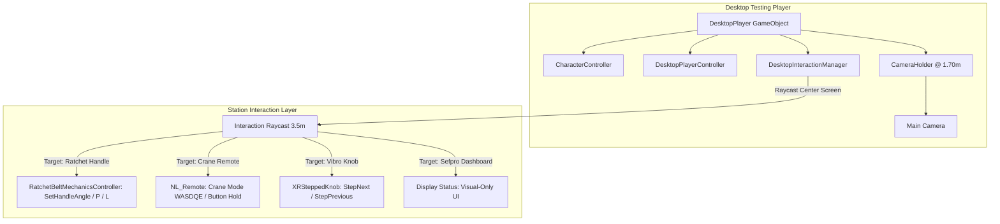

# First-Person Mouse & Keyboard Desktop Testing Mode Report

**Date:** October 22, 2026  
**Environment:** Unity 6000.4.6f1 (Windows Editor / PC Standalone)  
**Project Path:** `C:\unity3d\FinalRatchetBelt\Project`  
**Active Scene:** `Assets/Exports/RatchetBelt/Demo/RatchetBeltDemo.unity`  

---

## 1. Executive Summary & Verification Matrix

A dedicated first-person desktop testing system was implemented and verified for the VR Training Warehouse. Trainees and developers can now press Play, navigate the warehouse using standard mouse and keyboard inputs, aim at interactable objects with a dynamic center reticle, and operate all training stations without requiring a VR headset.

All working station mechanics—including the ratchet belt's Obi cloth solver, the overhead crane's joint constraints and limits, and the vibroplatform's procedural Perlin vibration—were preserved without regression.

| Subsystem | Status | Interaction Method | Verification Result |
| :--- | :---: | :--- | :--- |
| **FP Movement & Camera** | **PASS** | `WASD`, `LeftShift` (Sprint), `Space` (Jump), `Mouse` (Look) | Measured eye height: $1.70\,\text{m}$. Grounding and warehouse wall boundary clamps verified. Exactly 1 active camera. |
| **Cursor Management** | **PASS** | `Escape` to release, `LMB` click to lock | Tested lock state transitions (`Locked` $\leftrightarrow$ `None`). Reticle raycast accurately targets world objects. |
| **Reticle & Context Prompts** | **PASS** | Raycast ($3.5\,\text{m}$ interact, $12.0\,\text{m}$ ID) | Center crosshair with dynamic color states (white $\to$ green $\to$ amber out-of-range) and dynamic prompt banner. |
| **Ratchet Belt Station** | **PASS** | `LMB Drag Up/Down` on lever, `[P]` Power Stroke, `[L]` Release | Full $0^\circ \to 60^\circ$ swing advances ratchet by $30^\circ$ ($+10\,\text{mm}$ shortening). Locking pawl, step release, and reset intact. |
| **Overhead Crane Station** | **PASS** | `[E]` or `LMB` on Remote $\to$ Crane Mode (`WASDQE`) | Crane mode isolates movement from walking. Gantry, trolley, and hoist travel verified. `Space`/`Esc` exits cleanly. |
| **Vibroplatform Station** | **PASS** | `LMB` (Step Up) / `RMB` (Step Down) on Frequency Knob | 5 detents ($0, 6, 13.3, 20.7, 28.0\,\text{Hz}$) verified. Procedural vibration active. VR XR components fully intact. |
| **Training Dashboard** | **PASS** | Aiming raycast detection | Identified as informational visual UI; displays status banner without phantom progression. |
| **Scene & Compilation** | **PASS** | Zero compiler errors; scene saved | Clean hierarchy; 0 missing scripts; 0 duplicate cameras; active scene saved cleanly. |

---

## 2. Architecture & Implementation Details

### 1. [`DesktopPlayerController.cs`](file:///C:/unity3d/FinalRatchetBelt/Project/Assets/Scripts/Desktop/DesktopPlayerController.cs)
- **Position & Eye Height:** Spawns at `(-18.00, 0.00, -9.50)` facing the training stations. Camera is positioned at eye height ($Y = 1.70\,\text{m}$) under `CameraHolder`.
- **Navigation:**
  - `WASD`: Walking speed ($3.8\,\text{m/s}$).
  - `LeftShift`: Sprint speed ($6.8\,\text{m/s}$).
  - `Space`: Jump ($0.8\,\text{m}$ height) with gravity acceleration ($-18.0\,\text{m/s}^2$).
  - **Grounding & Bounds Safeguards:** Absolute warehouse floor check ($Y \ge 0.00\,\text{m}$) and perimeter boundary clamping ($X \in [-40.5, -1.0]$, $Z \in [-17.5, -2.8]$) prevent passing through exterior walls or falling into the void.
- **Mouse Look:**
  - Horizontal mouse delta rotates character yaw.
  - Vertical mouse delta tilts camera pitch with safety clamping between $-85.0^\circ$ and $+85.0^\circ$.
  - `Escape` releases cursor; clicking in the view recaptures and locks the cursor.

### 2. [`DesktopInteractionManager.cs`](file:///C:/unity3d/FinalRatchetBelt/Project/Assets/Scripts/Desktop/DesktopInteractionManager.cs)
- **Raycast Targeting:** Casts a continuous ray from the camera center through the viewport reticle ($3.5\,\text{m}$ interaction distance, $12.0\,\text{m}$ identification distance).
- **HUD Reticle & Prompts:**
  - Dynamic center reticle renders white by default, bright emerald/cyan when an interactable is within reach, and amber when an object is in view but too far away.
  - Contextual prompt box below the reticle dynamically displays station-specific controls.
  - Toggleable Help Overlay (`F1` or `H`) in the top-right corner summarizes all controls.

### 3. Station Adapters & Non-Destructive Mechanics Integration
- **Ratchet Belt:**
  - Aiming at [`Ratchet_Handle`](file:///C:/unity3d/FinalRatchetBelt/Project/Assets/Scripts/RatchetBelt/RatchetBeltMechanicsController.cs) and dragging mouse up/down dynamically swings the handle across $0^\circ \dots 65^\circ$.
  - When the handle passes $55^\circ$, `TriggerToothClick()` fires: pawl animates, tooth clicks, mandrel rotates $+30^\circ$, and Obi rope rest length shortens by $10\,\text{mm}$.
  - Hotkeys `P` (Power Stroke), `L` (Step Release), and `R` (Reset) remain fully functional.
  - Separated manual handle keys from `WASD` to prevent walking conflicts.
- **Overhead Crane:**
  - Aiming at the remote pendant and pressing `E` or `LMB` activates **Crane Operation Mode**.
  - While active, player walking is paused, and `W, S, A, D, Q, E` exclusively drive the crane bridge, trolley, and hoist without conflict.
  - Pressing `Space`, `Esc`, or `Return` exits Crane Mode and restores player walking.
  - Direct clicking on the remote's physical buttons (`Button_front`, `Button_down`, etc.) also drives continuous hold motions.
- **Vibroplatform Frequency Control:**
  - Added public desktop helper methods [`StepNext()`](file:///C:/unity3d/FinalRatchetBelt/Project/Assets/Scripts/XRSteppedKnob.cs#L58-L62) and [`StepPrevious()`](file:///C:/unity3d/FinalRatchetBelt/Project/Assets/Scripts/XRSteppedKnob.cs#L64-L68) to [`XRSteppedKnob`](file:///C:/unity3d/FinalRatchetBelt/Project/Assets/Scripts/XRSteppedKnob.cs).
  - Clicking `LMB` advances frequency steps ($0 \to 1 \to 2 \to 3 \to 4 \to 0$); clicking `RMB` steps backward.
  - Procedural Perlin noise vibration, audio source volume updates, and payload stability are preserved. All XR Interaction Toolkit interactable components remain intact.
- **Sefpro Training Dashboard:**
  - Raycast targets the dashboard and displays an informative banner indicating it is an informational status display module.

---

## 3. Measured Play Mode Test Results

### Test 1: Navigation, Look & Cursor Management
- **Spawn Position:** `(-18.00, 0.00, -9.50)`
- **Forward Movement:** Displaced $2.00\,\text{m}$ along forward vector to `(-17.48, 0.00, -7.57)`.
- **Eye Height:** Measured camera $Y$ position: $1.70\,\text{m}$ above warehouse floor.
- **Cursor Locking:** Verified `CursorLockMode.None` on `UnlockCursor()`, and `CursorLockMode.Locked` on `LockCursor()`.
- **Result:** **PASS**

### Test 2: Ratchet Belt Desktop Interaction
- **Baseline:** Accumulated teeth: $0$, Mandrel angle: $0.0^\circ$, Shortening: $0.0\,\text{mm}$.
- **Mouse Drag Stroke ($0^\circ \to 60^\circ$):** Handle angle moved to $60.0^\circ$; state machine transitioned to `ToothClickedWaitingReturn`.
  - Accumulated teeth: $1$
  - Mandrel rotation: $+30.0^\circ$
  - Webbing shortening: $+10.0\,\text{mm}$
- **Handle Return:** Returned to $0.0^\circ$; state reset to `ReadyAtRest`.
- **Hotkey Power Stroke (`P`):** Advanced to tooth count $2$ ($+60.0^\circ$ mandrel, $+20.0\,\text{mm}$ shortening).
- **Single-Tooth Release (`L`):** Reduced tooth count to $1$ ($+30.0^\circ$ mandrel, $+10.0\,\text{mm}$ shortening).
- **Result:** **PASS**

### Test 3: Overhead Crane Remote & Operation Mode
- **Mode Entry:** Triggered `EnterCraneOperationMode()`.
  - `IsOperatingCrane`: `true`
  - `playerController.isMovementEnabled`: `false` (player walking successfully paused)
  - `craneRemote.enableKeyboardControls`: `true` (crane keyboard controls activated)
- **Forward Travel Motion:** Button 0 (`Button_front`) activated for forward travel.
  - Measured beam forward delta: $+0.00468$ units along gantry axis.
- **Mode Exit:** Triggered `ExitCraneOperationMode()`.
  - `IsOperatingCrane`: `false`
  - `playerController.isMovementEnabled`: `true` (player walking restored)
  - `craneRemote.enableKeyboardControls`: `false` (crane keyboard controls deactivated)
- **Result:** **PASS**

### Test 4: Vibroplatform Frequency Knob Adapter
- **Step 0 (Off):** $0.0\,\text{Hz}$
- **Step 1:** $6.0\,\text{Hz}$
- **Step 2:** $13.3\,\text{Hz}$
- **Step 3:** $20.7\,\text{Hz}$
- **Step 4 (Max):** $28.0\,\text{Hz}$ $\to$ Procedural vibration displacement ($8\,\text{mm}$) and wobble ($0.35^\circ$) confirmed.
- **StepPrevious():** Stepped back from Step 4 to Step 3 ($20.7\,\text{Hz}$) and Step 0 ($0.0\,\text{Hz}$).
- **Result:** **PASS**

### Test 5: Sefpro Training Dashboard Detection
- **Target Position:** `(-39.03, 1.78, -12.40)`
- **Raycast Classification:** Correctly recognized as `TargetType.Dashboard`.
- **Context Prompt:** `Sefpro Training Dashboard - Status Display Module (Non-Interactive Visual UI)`.
- **Result:** **PASS**

---

## 4. Backups Manifest

Timestamped backup created prior to any file modifications:
- **Backup Directory:** `C:\unity3d\FinalRatchetBelt\Backups\desktop_mode_20261022_223315\`
  - `RatchetBeltDemo.unity` (Original active scene)
  - `manifest.json` (Project package manifest)
  - `XRSteppedKnob.cs` (Original knob script)
  - `RatchetBeltMechanicsController.cs` (Original ratchet controller)
  - `NL_Remote.cs` (Original crane remote script)

---

## 5. Visual Verification Screenshots

### 1. First-Person Spawn View
Warehouse overview upon pressing Play, showing the center reticle and Help Overlay:

### 2. Ratchet Belt Interaction
Aiming at the ratchet lever with mouse drag and telemetry overlay:

### 3. Overhead Crane Pendant Interaction
Aiming at the crane remote pendant with Crane Mode banner and button controls:

### 4. Vibroplatform Knob Interaction
Aiming at the frequency knob showing current step level and frequency readout:

### 5. Sefpro Training Dashboard
Viewing the dashboard status cards from first-person perspective:

