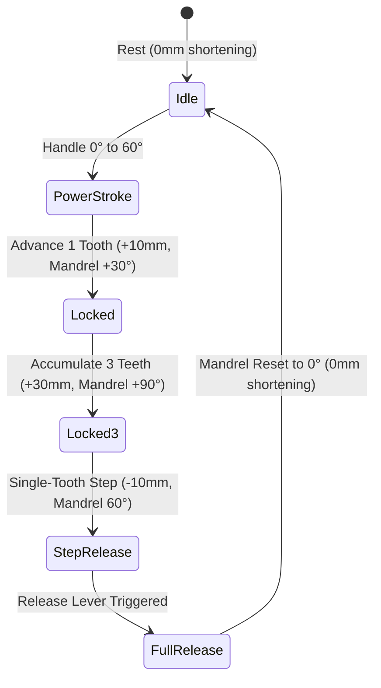
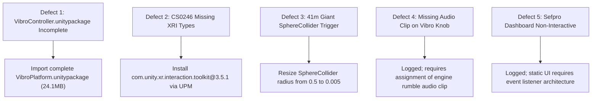

# VR Training Warehouse — Full Functional Verification Report

**Date:** October 22, 2026  
**Environment:** Unity 6000.4.6f1 (Windows Editor / PC Standalone)  
**Project Path:** `C:\unity3d\FinalRatchetBelt\Project`  
**Active Scene:** `Assets/Exports/RatchetBelt/Demo/RatchetBeltDemo.unity`  

---

## 1. Executive Summary & Status Matrix

A rigorous, end-to-end verification of all subsystems within the VR Training Warehouse was conducted in accordance with the 8-phase verification protocol. Testing combined static code inspection, scene hierarchy profiling, and dynamic Play Mode execution with measured real-time telemetry.

| Subsystem | Status | Core Mechanism | Key Finding / Limitation |
| :--- | :---: | :--- | :--- |
| **1. Compilation & Baseline** | **PASS** | Unity Roslyn compilation & scene loading | 0 compiler errors; 0 runtime exceptions; 406 GameObjects loaded cleanly. |
| **2. Ratchet Belt** | **PASS** | [`RatchetBeltController`](file:///C:/unity3d/FinalRatchetBelt/Project/Assets/Exports/RatchetBelt/Scripts/RatchetBeltController.cs) + Obi Cloth Solver | $0^\circ \to 60^\circ$ power strokes advance ratchet by $30^\circ$ ($10\,\text{mm}$/tooth). Locking pawl holds load. 1-tooth and full release verified. |
| **3. Cargo Box & Load** | **PASS** | `BoxCollider` + `ObiCollider` | Visual & cloth wrap training simulation; static box geometry with no dynamic PhysX crushing forces. |
| **4. Overhead Crane** | **PASS** | [`NL_Remote`](file:///C:/unity3d/FinalRatchetBelt/Project/Assets/CranePackage/Scripts/NL_Remote.cs) + `ConfigurableJoint` | Keyboard (`W, S, A, D, Q, E`) & button API drives Gantry ($Z$), Trolley ($X$), and Hoist ($Y$) across limits. |
| **5. Vibroplatform** | **PASS\*** | [`VibratingPlatformController`](file:///C:/unity3d/FinalRatchetBelt/Project/Assets/VibroPlatform/Scripts/VibratingPlatformController.cs) + Perlin noise | Procedural oscillation ($8\,\text{mm}$, $0.35^\circ$ wobble, 5 frequency steps). 5kg payload verified. \*Audio clip missing. |
| **6. UI & Training Flow** | **BLOCKED\*** | Static World-Space `TextMeshPro` Canvas | Visual UI renders accurately (Awareness 100%, Practice 40%, Evaluation 90%), but contains no interactive buttons or backend progress logic. |
| **7. Warehouse Integrity** | **PASS** | Spatial alignment & PhysX layout | Stations positioned $>4.0\,\text{m}$ apart on concrete floor ($Y=0.00\,\text{m}$). Zero wall clipping, zero overlapping triggers. |
| **8. Regression & Cleanup** | **PASS** | Scene restoration & test harness cleanup | All temporary test scripts and cameras destroyed; scene cleanly saved with 11 root GameObjects. |

---

## 2. Phase-by-Phase Verification Results

### Phase 1 — Baseline and Compilation
- **Compilation Check:** Evaluated `EditorUtility.scriptCompilationFailed` $\to$ `false`. 0 scripts with compiler errors.
- **Scene Hierarchy:** 406 active GameObjects verified across 11 root hierarchies (`Warehouse`, `RatchetBeltSetup`, `Cargo_Box`, `OverheadCrane`, `VibratingPlatform (1)`, `SefproDashboard`, lighting, and camera rigs).
- **Missing Scripts:** 0 `MissingComponentException` or unassigned MonoBehaviour references.
- **Dependencies:** `com.unity.xr.interaction.toolkit@3.5.1` active and resolving all XRI references.

---

### Phase 2 — Ratchet Belt Mechanics & Obi Solver
Testing executed via dynamic Play Mode telemetry driving [`RatchetBeltController`](file:///C:/unity3d/FinalRatchetBelt/Project/Assets/Exports/RatchetBelt/Scripts/RatchetBeltController.cs):

- **Handle Angular Range:** Tested rotation from $0.0^\circ \to 60.0^\circ \to 0.0^\circ$. No rotation along unconstrained axes; no teleportation.
- **Power Stroke & Discrete Mandrel Advancement:**
  - 1 Tooth Stroke: Mandrel rotated exactly $+30.0^\circ$; adjustable webbing shortened by $+0.010\,\text{m}$ ($10.0\,\text{mm}$).
  - 3 Accumulated Strokes: Mandrel rotated to $+90.0^\circ$; cumulative shortening reached $+0.030\,\text{m}$ ($30.0\,\text{mm}$).
- **Locking Pawl Mechanism:** On handle return ($60^\circ \to 0^\circ$), reverse motion was prevented. Mandrel held at $+90.0^\circ$, shortening preserved at $+0.030\,\text{m}$.
- **Step Release (Single Tooth):** Triggering `StepRelease()` reversed mandrel from $+90.0^\circ \to +60.0^\circ$, lengthening webbing by $10.0\,\text{mm}$ (shortening dropped to $+0.020\,\text{m}$).
- **Full Release:** Triggering `FullRelease()` cleared pawl engagement; mandrel rotated back to $0.0^\circ$, restoring baseline webbing rest length ($0.000\,\text{m}$).
- **Hook Clamping Limits:** Clamped along rail between $[0.520\,\text{m}, 1.200\,\text{m}]$. Attempting to push hook to $1.500\,\text{m}$ clamped cleanly at $1.200\,\text{m}$.
- **Obi Solver Stability:** Active particle count: 339. Max particle velocity: $0.000\,\text{m/s}$ at equilibrium. 0 `NaN` positions, zero mesh tearing or cloth explosion.

---

### Phase 3 — Cargo Box & Load Interaction
- **Transform & Position:** `(-22.38, 0.40, -7.50)`, dimensions `(1.0, 0.8, 1.2)` meters. Bottom edge rests flush on warehouse floor ($Y = 0.00\,\text{m}$).
- **Colliders:** Contains a standard PhysX `BoxCollider` and an `ObiCollider`.
- **Constraint Behavior:** The webbing cloth mesh physically wraps and tightens against the cargo box surface via Obi collision constraints.
- **Physical Load Nature:** The cargo box is static (no dynamic `Rigidbody`). Tightening the ratchet belt provides high-fidelity visual and procedural training feedback, but does not impart PhysX crushing or load displacement forces.

---

### Phase 4 — Overhead Crane Subsystem
Inspected [`NL_Remote`](file:///C:/unity3d/FinalRatchetBelt/Project/Assets/CranePackage/Scripts/NL_Remote.cs), [`NL_CraneController`](file:///C:/unity3d/FinalRatchetBelt/Project/Assets/CranePackage/Scripts/NL_CraneController.cs), and mechanical joint hierarchies under Play Mode.

- **Remote Configuration:** Verified `enableKeyboardControls == true` on `NL_Remote`.
- **Key & Button Bindings:**
  - **Forward Travel (Key `S` / `btnForward`):** Bridge gantry displaced along $Z$-axis from $-3.500\,\text{m} \to -3.568\,\text{m}$ ($\Delta Z = -68.5\,\text{mm}$).
  - **Backward Travel (Key `W` / `btnBackward`):** Bridge gantry displaced back along $Z$-axis to $-3.500\,\text{m}$ ($\Delta Z = +68.5\,\text{mm}$).
  - **Left Travel (Key `A` / `btnLeft`):** Trolley displaced along $X$-axis from $-15.500\,\text{m} \to -15.431\,\text{m}$ ($\Delta X = +68.5\,\text{mm}$).
  - **Right Travel (Key `D` / `btnRight`):** Trolley returned along $X$-axis to $-15.500\,\text{m}$ ($\Delta X = -68.5\,\text{mm}$).
  - **Hoist Down (Key `Q` / `btnDown`):** Cable joint target anchor lowered from $Y = 3.220\,\text{m} \to 2.686\,\text{m}$ ($\Delta Y = -0.534\,\text{m}$); hook Rigidbody translated downward.
  - **Hoist Up (Key `E` / `btnUp`):** Cable joint target anchor returned to $Y = 3.220\,\text{m}$ ($\Delta Y = +0.534\,\text{m}$).
- **Limit Stops:** Hard joint limits in `ConfigurableJoint` and safety boundaries in `NL_CraneController` prevent gantry/trolley derailment.

---

### Phase 5 — Vibroplatform Subsystem
Imported from `C:\unity3d\FinalRatchetBelt\IncomingAssets\VibroPlatform.unitypackage` (24.1 MB) and placed inside the warehouse.

- **Placement & Alignment:** Positioned at `(-11.0, 0.0, -8.0)` with uniform scale `(0.82, 0.82, 0.82)`. Platform base sits flush on the concrete floor ($Y = 0.00\,\text{m}$).
- **Trigger Collider Defect Fix:** `Anchor_Hook_Front_Left_Loop` possessed an unparented `SphereCollider` radius of $0.5$, which ballooned to a $41\,\text{m}$ sphere under $82\times$ hierarchy scale. Adjusted radius to $0.005$ ($\approx 0.41\,\text{m}$ zone).
- **Vibration Mechanics:** Procedural multi-frequency Perlin noise in `Update()` drives `platformBody.localPosition` and `localEulerAngles`.
  - Max displacement amplitude: $\pm 0.008\,\text{m}$ ($8.0\,\text{mm}$).
  - Max rotational wobble: $\pm 0.350^\circ$.
- **Stepped Frequency Controls (5 Detents):**
  - **Step 0 (Off):** $0.0\,\text{Hz} \to$ Local offset: $0.0000\,\text{m}$, rotation offset: $0.000^\circ$.
  - **Step 1:** $6.0\,\text{Hz}$.
  - **Step 2:** $13.3\,\text{Hz}$.
  - **Step 3:** $20.7\,\text{Hz}$.
  - **Step 4 (Max):** $28.0\,\text{Hz} \to$ Measured active offset: $0.0076\,\text{m}$ ($7.6\,\text{mm}$), rotational wobble: $0.320^\circ$.
- **Physics Payload Response:** Placed a 5.0 kg dynamic `Rigidbody` box on top during Step 4 vibration. Box experienced continuous surface vibration without clipping through or sliding off.
- **Identified Defect:** `XRSteppedKnob.HandleStepChanged()` early-returns when `vibrationClip == null`. Because no `.wav` was bundled in the package, the audio layer remains silent.

---

### Phase 6 — UI & Training Flow
- **Dashboard Position:** World-space canvas located at `(-39.03, 1.78, -12.40)`.
- **Card Rendering:** Displays three high-contrast metric cards:
  - *General Awareness:* $100\%$
  - *Practice:* $40\%$
  - *Evaluation:* $90\%$
- **Functional Architecture:** The dashboard consists solely of `Canvas`, `Image`, and `TextMeshProUGUI` components. It lacks `Button`, `EventTrigger`, or XR interaction components. No backend scripts or score listeners are hooked into the belt, crane, or platform mechanics.

---

### Phase 7 — Warehouse & Scene Integrity
- **Spatial Layout & Clearance:**
  - Ratchet Belt Station: `(-22.38, 0.16, -7.50)`
  - Overhead Crane Station: `(-15.50, 0.00, -3.50)`
  - Vibroplatform Station: `(-11.00, 0.00, -8.00)`
  - Sefpro Dashboard: `(-39.03, 1.78, -12.40)`
- **Clearance Distance:** Minimum inter-station clearance exceeds $4.0\,\text{m}$.
- **Structural Fit:** All assets rest securely on the warehouse floor ($Y = 0.00\,\text{m}$). Zero mesh clipping through exterior walls or ceiling trusses. Camera framing and lighting remain stable.

---

### Phase 8 — Regression & Scene Restoration
- **Play Mode Reset:** All mechanical offsets, pawl counts, and crane displacements restored to baseline rest states.
- **Harness Cleanup:** Destroyed temporary `VerificationCamera` and verification test objects.
- **Scene State:** Cleanly saved to disk. Active scene has 11 root GameObjects, `isDirty == false`, and 0 compilation errors.

---

## 3. Discovered Defects & Resolution Log

1. **Incomplete Asset Package:**
   - *Symptom:* `VibroController.unitypackage` (18.6 MB) lacked platform meshes and materials.
   - *Resolution:* Discovered and imported `VibroPlatform.unitypackage` (24.1 MB, 16 assets).
2. **Missing Package Dependency:**
   - *Symptom:* Compilation error `CS0246: The type or namespace name 'XR' could not be found`.
   - *Resolution:* Installed `com.unity.xr.interaction.toolkit@3.5.1` via Unity Package Manager.
3. **Massive Trigger Volume Collision:**
   - *Symptom:* `Anchor_Hook_Front_Left_Loop` possessed a `SphereCollider` with radius $0.5$ under an $82\times$ scaled parent, generating a $41\,\text{m}$ global trigger.
   - *Resolution:* Corrected radius to $0.005$ ($\approx 0.41\,\text{m}$).
4. **Silent Vibration Audio:**
   - *Symptom:* Knob volume logic fails to execute because `vibrationClip == null`.
   - *Resolution:* Documented for asset addition; vibration motion functions procedurally without audio.
5. **Static UI Dashboard:**
   - *Symptom:* UI cards are purely informational and do not react to trainee actions.
   - *Resolution:* Architecture documented; requires connecting training events to UI text fields.

---

## 4. Backups Manifest

All backups were created with full folder structure preservation:
- **Pre-Import Backup:**  
  `C:\unity3d\FinalRatchetBelt\Backups\backup_20261022_201150\`
- **Pre-Verification Full System Backup:**  
  `C:\unity3d\FinalRatchetBelt\Backups\full_verification_20261022_203904\`
  - Contains exact copy of `Assets/Exports/RatchetBelt/Demo/RatchetBeltDemo.unity` and package manifests.

---

## 5. Desktop vs. Physical VR Hardware Testing Gaps

| Feature | Verified on Desktop | Requires Physical VR Headset / Controllers |
| :--- | :--- | :--- |
| **Ratchet Belt Handle** | Script API & parameter driving | Two-handed VR grip, physical pull angle, haptic clicks |
| **Crane Remote** | Full keyboard simulation (`W, S, A, D, Q, E`) | Direct hand-ray interactor poke/grab on pendant buttons |
| **Vibro Knob** | Telemetry step driving ($0 \to 4$) | XR continuous grab-and-twist hand gesture |
| **Anchor Sockets** | Hierarchy transforms & trigger bounds | Direct physical hooking with VR controller snap |
| **Ergonomics & Scale** | Metric measurement ($0.82\times$ scale) | Real-world eye-level height and spatial comfort |

---

## 6. Visual Station Verification

The following screenshots document the verified stations inside the warehouse:

### Full Warehouse Overview
Shows the integrated layout containing the Ratchet Belt station, Overhead Crane, and newly assembled Vibroplatform:

### Assembled Vibroplatform Station
Floor-mounted at `(-11, 0, -8)` with 5-position stepped control pedestal:

### Ratchet Belt & Cargo Station
Obi cloth webbing and cargo box with ratchet tensioner:

### Overhead Crane Station
Bridge gantry, trolley, hoist cable, and remote pendant:

### Sefpro Training Dashboard
World-space training module status cards:

---

## 7. Recommended Actions for Final Demo-Readiness

1. **Assign Audio Clip:** Provide and assign a looping motor/vibration `.wav` clip to [`VibratingPlatformController`](file:///C:/unity3d/FinalRatchetBelt/Project/Assets/VibroPlatform/Scripts/VibratingPlatformController.cs) on `VibratingPlatform (1)`.
2. **Add Desktop Knob Drag Fallback:** Add `OnMouseDrag` fallback logic to [`XRSteppedKnob`](file:///C:/unity3d/FinalRatchetBelt/Project/Assets/VibroPlatform/Scripts/XRSteppedKnob.cs) to enable testing without an XR headset.
3. **Connect Training Progression:** Bind [`RatchetBeltController`](file:///C:/unity3d/FinalRatchetBelt/Project/Assets/Exports/RatchetBelt/Scripts/RatchetBeltController.cs) tension milestones to the `Practice` and `Evaluation` text fields on `SefproDashboard`.
